# 考试题型

理论+操作 两门都要60分才可通过，都是100分满分

## 理论题（90分钟）

理论考试题型：判断20+==单选70==+多选10=100分

理论考试题量：40+140+10题

题库数量：300+300+300

多选可视情况 放弃

题库包含70%多考试题目，考试宝中 进入【题型练习】 练习判断和单选题

## 操作题（120分钟）

时间将会非常紧迫

代码题：代码填空

论述题：打字发表观点

- 业务分析（25分）【10题抽1题】—25分钟

  - 业务流程设计（代码题）  【题库5题】

  - 业务模块效果优化（论述题） 【题库5题】

- 智能训练

  - 数据处理规范制定（15分）【题库5题】—20分钟

  - 算法测试（15分）题库5题】—20分钟

- 智能系统设计
  - 智能系统监控和优化（15分）（Excel操作）【题库5题】—20分钟
  - 人机交互流程设计（20分）【题库5题】—20分钟
- 培训与指导（5分）【10题抽1题】—5分钟
  - 培训（中文填空）【题库5题】
  - 指导（中文填空）【题库5题】

==考试时要先【下载素材】==

# 5.17课程

==Excel操作：数据透视表和分列==

数据透视表：选择数据包含列名不要空格—>插入—>数据透视表 -> 右下角拖动字段到下面 点击字段设置字段统计方式（求和、平均数等）

分列：新增一列 -> 选中数据列 -> 点击数据 -> 分列 -> 选中分隔符为空格 -> 下一步选择数据格式为文本->加个列名

## 优化方向答题思路（6分）

1、硬件（CPU、内存、网络硬件）

2、软件（智能算法、软件架构）

3、网络（网络协议、网络硬件）

4、个性化（易用性、颜色）

5、人机界面（易用性、操作方便）

## 题库3.1.1解析

**响应时间适中的功能是中间随便选三个**

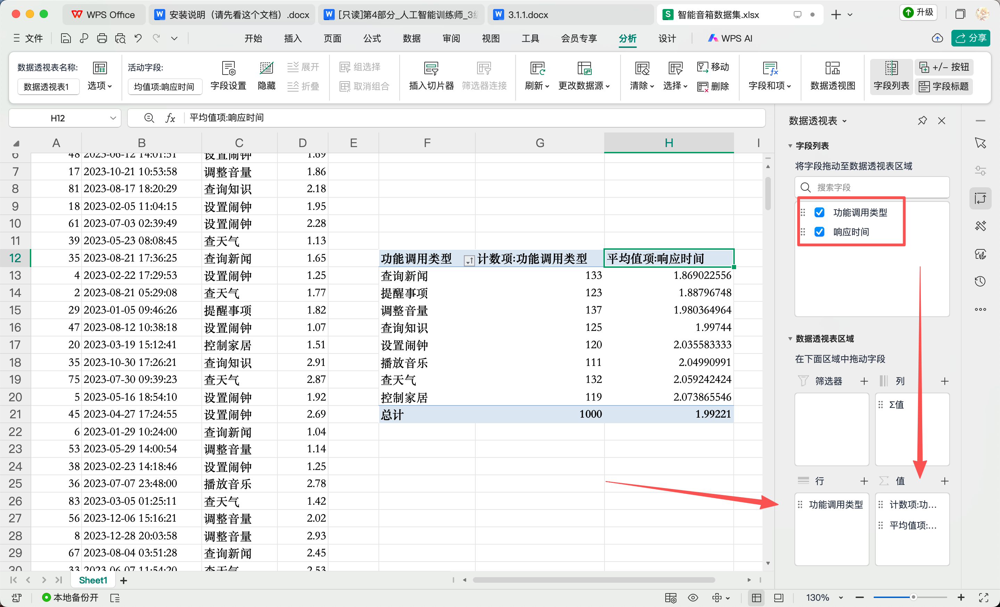

## 题库3.1.2解析

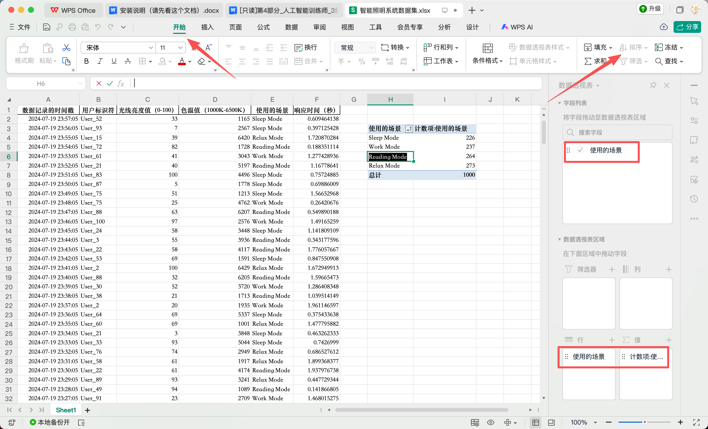

## 题库3.1.3解析

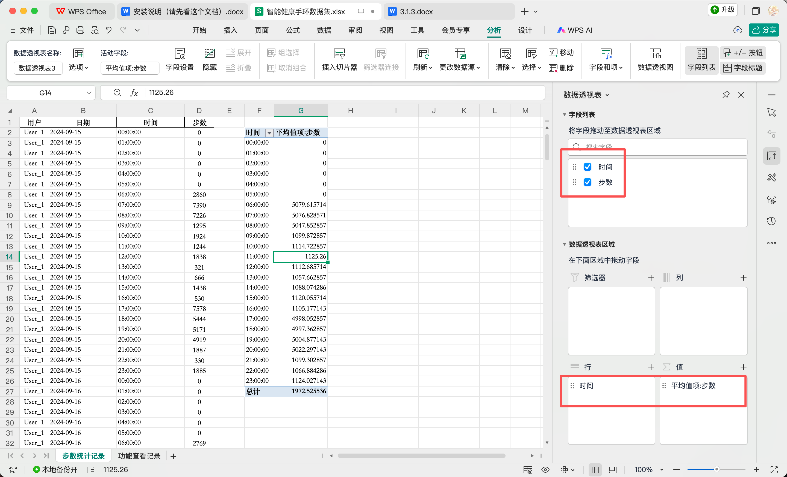

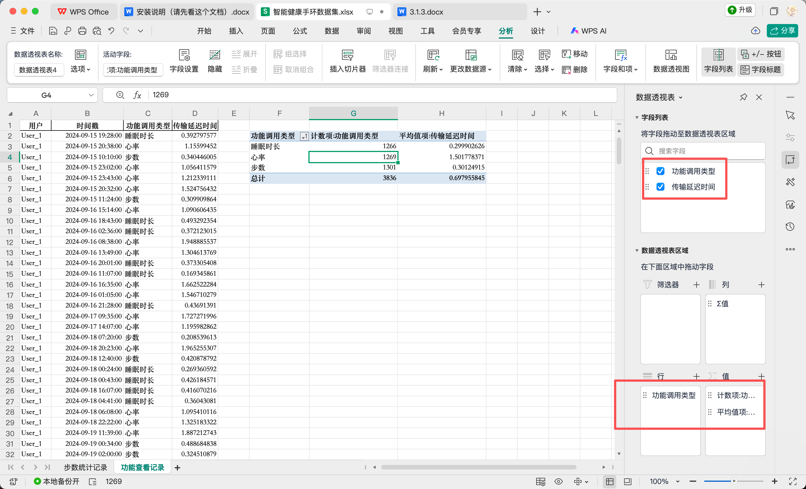

## 题库3.1.4解析

响应时间筛选后求平均值

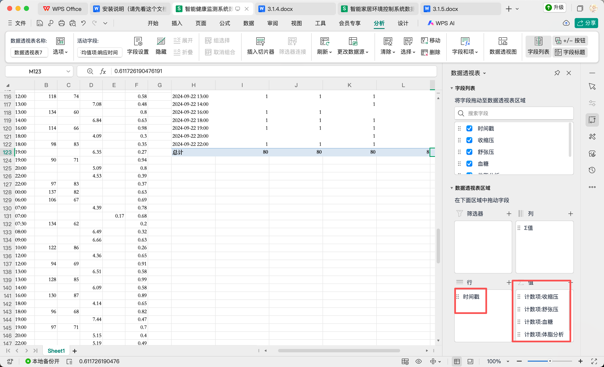

## 题库3.1.5解析

智能家居环境

==记住用户环境偏好时间段==

06-12

13-18

19-05

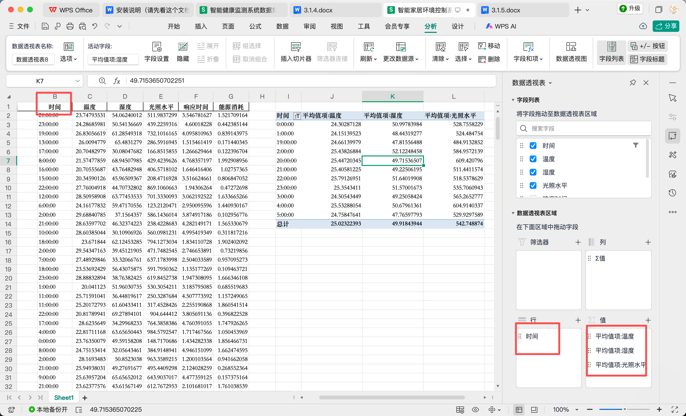

## 环境配置

```perl
 cd /Users/yukiasumi/Downloads/ai/ && source yukienv/bin/activate
pip install jupyter \
  --trusted-host mirrors.aliyun.com \
  --trusted-host pypi.org \
  --trusted-host files.pythonhosted.org
cd /Users/yukiasumi/Downloads/ai/题库
jupyter notebook
```

## pandas常用方法

- 查询函数：dir(pandas.DataFrame) 和 dir(pandas)

- 读取导入Excel：
  - data = pandas.read_csv('文件名')

  - data = pandas.read_csv('文件名',encoding='gbk')

- 判断空行：data.isnull()
- 判断重复值：data.duplicated()
- 计数：data.sum()

- 删除有空格的行：data.dropna() 

- 删除重复行：data.drop_duplicates() 
- 取前N行（默认前5行）：data.head() 
- 重命名：data.rename({},inplace=True)
- 查看信息：data.info()

- pandas.to_datetime(data[‘’字段名称])
- pandas.get_dummies(X)  # 将分类变量转为数值变量(独热编码)


- 取平均值：data[‘字段名称’].mean()
- 取标准差：data[‘字段名称’].std()
- 类型转换：data[‘字段名称’].astype(类型名称)  
- 分类计算各几个：data[‘字段名称’].value_counts()
- 取范围：data[‘字段名称’].between(范围1，范围2)


## numpy常用方法

- np.where(布尔条件，‘True值’，‘False值’)

  ```python
  #大于7天高风险
  np.where(data['DaysinHospital']>7, '高风险患者', '低风险患者')
  ```

- 

## 题库1.1.3解析

```python
import pandas as pd
import numpy as np
import matplotlib.pyplot as plt
# 读取数据集
data = pd.read_csv('credit_data.csv')
print(data)

# 1. 数据完整性审核
missing_values = data.isnull().sum()       #数据缺失值统计 2分
duplicate_values = data.duplicated().sum()     #数据重复值统计 2分
# 输出结果
print("缺失值统计:")
print(missing_values)
print("重复值统计:")
print(duplicate_values)

# 2. 数据合理性审核
data['is_age_valid'] = data['Age'].between(18, 70)              #Age数据的合理性审核 2分
data['is_income_valid'] = data['Income'] > 2000                #Income数据的合理性审核 2分
data['is_loan_amount_valid'] = data['LoanAmount'] < (data['Income'] * 5)      #LoanAmount数据的合理性审核 2分
data['is_credit_score_valid'] = data['CreditScore'].between(300, 850)   #CreditScore数据的合理性审核 2分
# 合理性检查结果
validity_checks = data[['is_age_valid', 'is_income_valid', 'is_loan_amount_valid', 'is_credit_score_valid']].all(axis=1)
data['is_valid'] = validity_checks
# 输出结果
print("数据合理性检查:")
print(data[['is_age_valid', 'is_income_valid', 'is_loan_amount_valid', 'is_credit_score_valid', 'is_valid']].describe())

# 3. 数据清洗和异常值处理
# 标记不合理数据
invalid_rows = data[~data['is_valid']]
# 删除不合理数据行
cleaned_data = data[data['is_valid']]
# 删除标记列
cleaned_data = cleaned_data.drop(columns=['is_age_valid', 'is_income_valid', 'is_loan_amount_valid', 'is_credit_score_valid', 'is_valid'])
# 保存清洗后的数据
cleaned_data.to_csv('cleaned_credit_data.csv', index=False)
print("数据清洗完成，已保存为 'cleaned_credit_data.csv'")
```

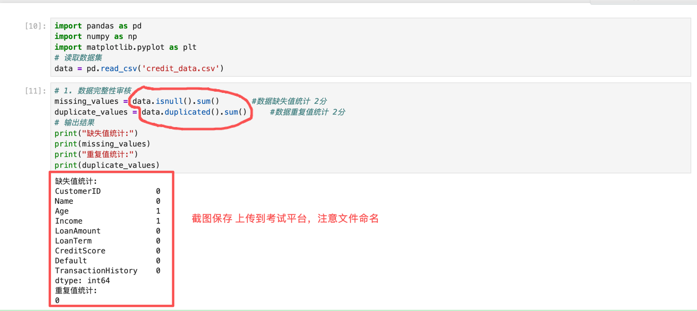

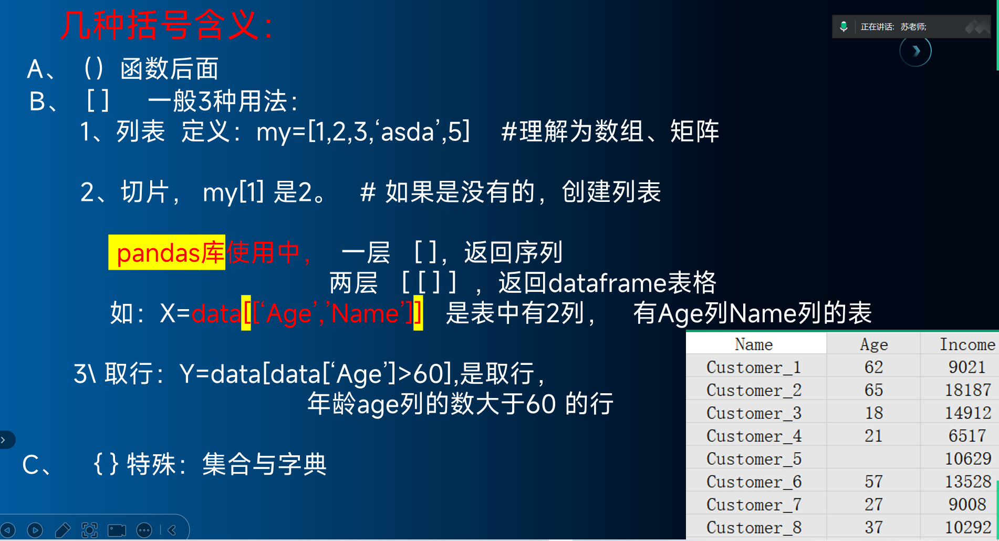

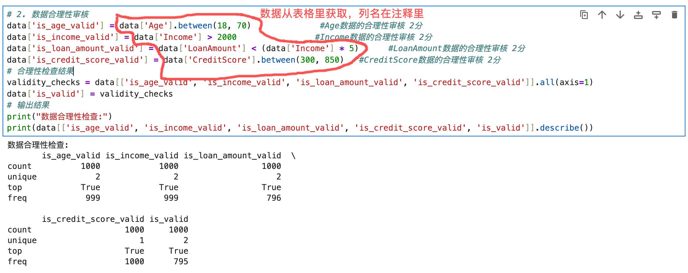

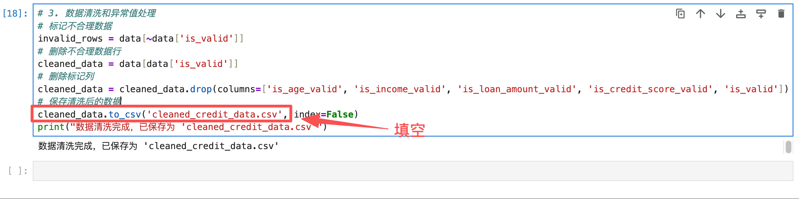

## 题库1.1.4解析

```python
import pandas
import numpy as np
import matplotlib.pyplot as plt

# 1. 数据采集
# 从本地文件中读取数据  2分
data =  pandas.read_csv('user_behavior_data.csv')
print("数据采集完成，已加载到DataFrame中")

# 打印数据的前5条记录  2分
print(data.head())

# 2. 数据清洗与预处理
# 处理缺失值（删除）  2分
data = data.dropna()


# 数据类型转换
data['Age'] = data['Age'].astype(int)   # Age数据类型转换为int 2分
data['PurchaseAmount'] = data['PurchaseAmount'].astype(float) # PurchaseAmount数据类型转换为float  2分
data['ReviewScore'] = data['ReviewScore'].astype(int)   # ReviewScore数据类型转换为int 2分

# 处理异常值  2分
data = data[(data['Age'].between(18, 70)) & 
            (data['PurchaseAmount'] > 0) & 
            (data['ReviewScore'].between(1, 5))]

# 数据标准化
data['PurchaseAmount'] = (data['PurchaseAmount'] - data['PurchaseAmount'].mean()) / data['PurchaseAmount'].std()  # PurchaseAmount数据标准化 2分
data['ReviewScore'] = (data['ReviewScore'] - data['ReviewScore'].mean()) / data['ReviewScore'].std()        # ReviewScore数据标准化 2分

# 保存清洗后的数据  1分
data.to_csv('cleaned_user_behavior_data.csv', index=False)
print("数据清洗完成，已保存为 'cleaned_user_behavior_data.csv'")

# 3. 数据统计
# 统计每个购买类别的用户数 2分
purchase_category_counts = data['PurchaseCategory'].value_counts()
print("每个购买类别的用户数:\n", purchase_category_counts)

# 统计不同性别的平均购买金额 2分
gender_purchase_amount_mean = data.groupby('Gender')['PurchaseAmount'].mean()
print("不同性别的平均购买金额:\n", gender_purchase_amount_mean)

# 统计不同年龄段的用户数 2分
bins = [18, 26, 36, 46, 56, 66, np.inf]
labels = ['18-25', '26-35', '36-45', '46-55', '56-65', '65+']
data['AgeGroup'] = pandas.cut(data['Age'],bins=bins,labels=labels, right=False)
age_group_counts = data['AgeGroup'].value_counts().sort_index()
print("不同年龄段的用户数:\n", age_group_counts)
```


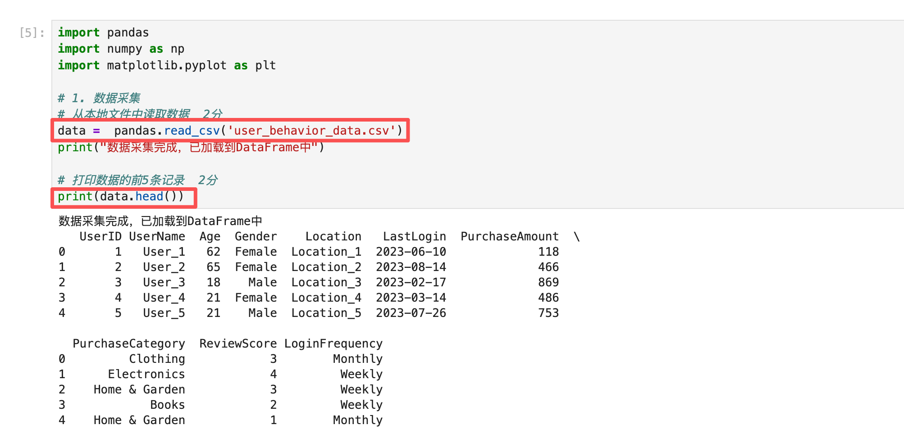

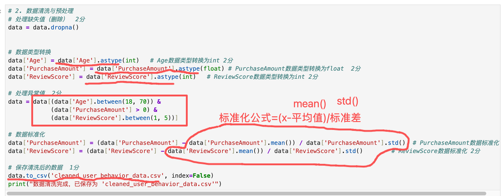

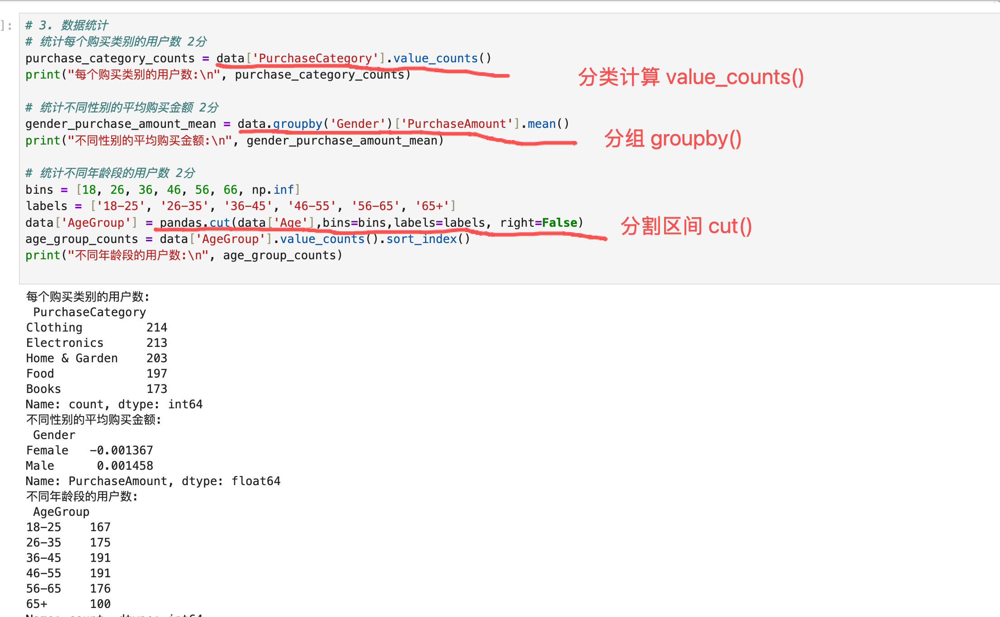

# 5.24课程

## 题库1.1.5解析

```python
import pandas as pd
import numpy as np
import matplotlib.pyplot as plt

# 1. 数据采集
# 从本地文件中读取数据  2分
data = pd.read_csv('vehicle_traffic_data.csv')
print("数据采集完成，已加载到DataFrame中")

# 打印数据的前5条记录 2分
print(data.head())

# 2. 数据清洗与预处理
# 处理缺失值（删除）  2分
data = data.dropna()

# 数据类型转换
data['Age'] = data['Age'].astype(int)       #Age数据类型转换为int 1分
data['Speed']= data['Speed'].astype(float)     #Speed数据类型转换为float 1分
data['TravelDistance'] = data['TravelDistance'].astype(float)     #TravelDistance数据类型转换为float 1分
data['TravelTime'] = data['TravelTime'].astype(float)     #TravelTime数据类型转换为float 1分

# 处理异常值  2分
data = data[(data['Age'].between(18, 70))  & 
            (data['Speed'].between(0, 200)) & 
            (data['TravelDistance'].between(1, 1000)) & 
            (data['TravelTime'].between(1, 1440))]

# 保存清洗后的数据  1分
data.to_csv('cleaned_vehicle_traffic_data.csv', index=False)
print("数据清洗完成，已保存为 'cleaned_vehicle_traffic_data.csv'")


# 3. 数据合理性审核
# 审核字段合理性 1分
unreasonable_data = data[~((data['Age'].between(18, 70)) & 
                           (data['Speed'].between(0, 200)) & 
                           (data['TravelDistance'].between(1, 1000)) & 
                           (data['TravelTime'].between(1, 1440)))]
print("不合理的数据:\n", unreasonable_data)

# 4. 数据统计
# 统计每种交通事件的发生次数  2分
traffic_event_counts = data['TrafficEvent'].value_counts()
print("每种交通事件的发生次数:\n", traffic_event_counts)

# 统计不同性别的平均车速、行驶距离和行驶时间  2分
gender_stats = data.groupby('Gender').agg({'Speed':'mean','TravelDistance':'mean','TravelTime':'mean'})
print("不同性别的平均车速、行驶距离和行驶时间:\n", gender_stats)

# 统计不同年龄段的驾驶员数  5分
age_bins = [18, 26, 36, 46, 56, 66, np.inf]
age_labels = ['18-25', '26-35', '36-45', '46-55', '56-65', '65+']
data['AgeGroup'] = pd.cut(data['Age'],bins=age_bins,labels=age_labels, right=False)
age_group_counts = data['AgeGroup'].value_counts()
print("不同年龄段的驾驶员数:\n", age_group_counts)
```


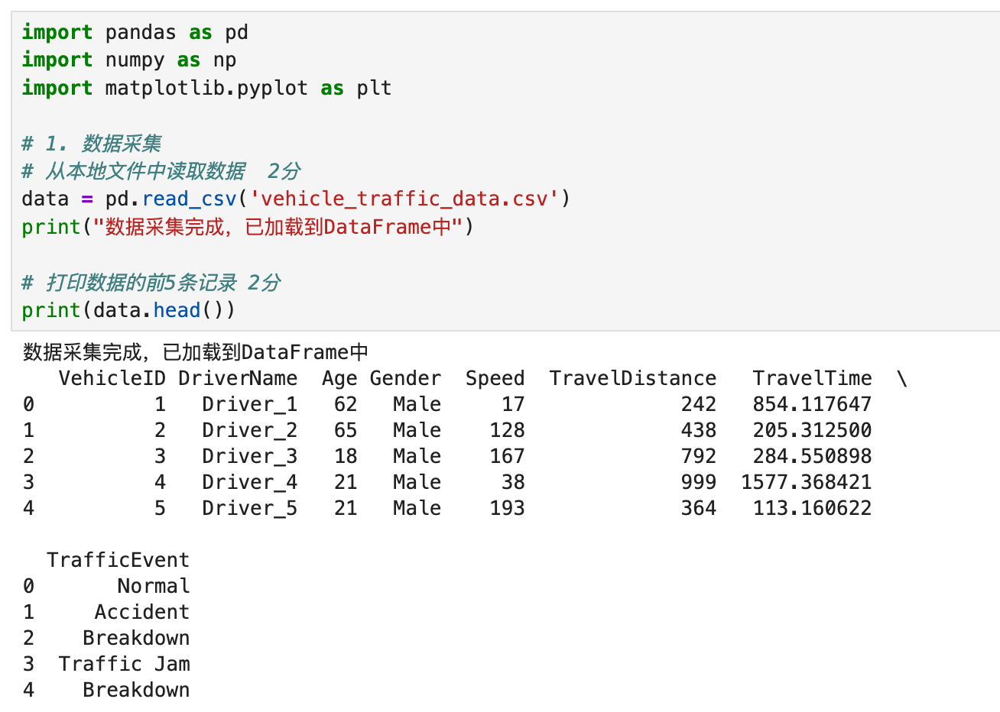

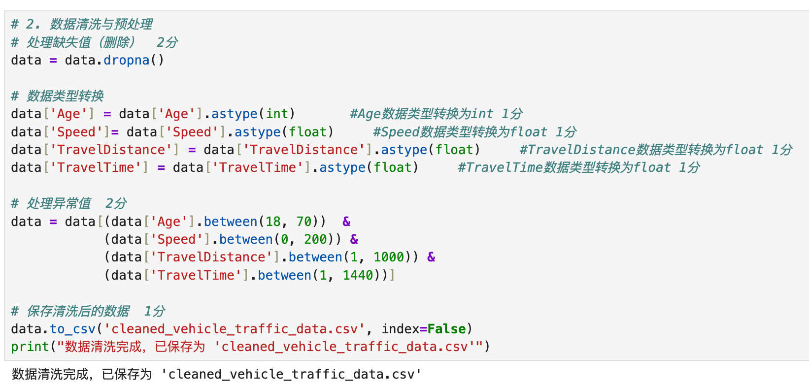

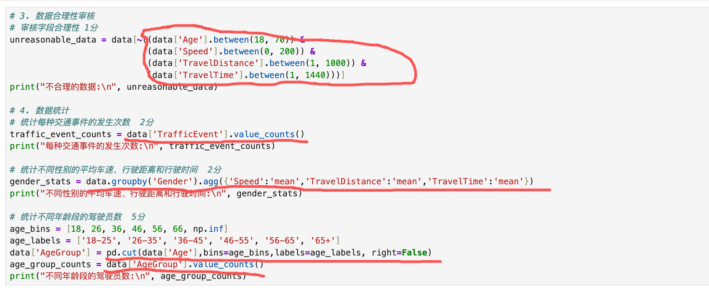

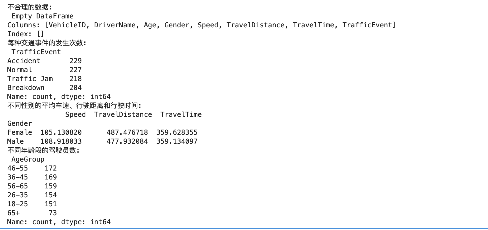

## 题库1.1.1解析

```python
import pandas as pd
import numpy as np

# 读取数据集 1分
data = pd.read_csv('patient_data.csv')

# 1. 统计住院天数超过7天的患者数量及其占比
# 创建新列'RiskLevel'，根据住院天数判断风险等级 3分
data['RiskLevel'] = np.where(data['DaysInHospital']>7, '高风险患者', '低风险患者')
# 统计不同风险等级的患者数量 2分
risk_counts = data['RiskLevel'].value_counts()
# 计算高风险患者占比 1分
high_risk_ratio = risk_counts['高风险患者'] / risk_counts.sum()
# 计算低风险患者占比 1分
low_risk_ratio = risk_counts['低风险患者'] / risk_counts.sum()

# 输出结果
print("高风险患者数量:", risk_counts['高风险患者'])
print("低风险患者数量:", risk_counts['低风险患者'])
print("高风险患者占比:", high_risk_ratio)
print("低风险患者占比:", low_risk_ratio)

# 2. 统计不同BMI区间中高风险患者的比例和统计不同BMI区间中的患者数
# 定义BMI区间和标签
bmi_bins = [0, 18.5, 24, 28, np.inf]
bmi_labels = ['偏瘦', '正常', '超重', '肥胖']
# 根据BMI值划分指定区间 4分
data['BMIRange'] = pd.cut(data['BMI'], bins=bmi_bins, labels=bmi_labels, right=False)  # 使用左闭右开区间
# 计算每个BMI区间中高风险患者的比例 2分
bmi_risk_rate = data.groupby('BMIRange')['RiskLevel'].apply(lambda x: (x == '高风险患者').mean())
# 统计每个BMI区间的患者数量 1分
bmi_patient_count = data['BMIRange'].value_counts()
# 输出结果
print("BMI区间中高风险患者的比例和患者数:")
print(bmi_risk_rate) 
print(bmi_patient_count)

# 3. 统计不同年龄区间中高风险患者的比例和统计不同年龄区间中的患者数
# 定义年龄区间和标签
age_bins = [0, 26, 36, 46, 56, 66, np.inf]
age_labels = ['≤25岁', '26-35岁', '36-45岁', '46-55岁', '56-65岁', '＞65岁']
# 根据年龄值划分指定区间 4分
data['AgeRange'] = pd.cut(data['Age'], bins=age_bins, labels=age_labels, right=False)  # 使用左闭右开区间
# 计算每个年龄区间中高风险患者的比例 2分
age_risk_rate = data.groupby('AgeRange')['RiskLevel'].apply(lambda x: (x == '高风险患者').mean())
# 统计每个年龄区间的患者数量 1分
age_patient_count = data['AgeRange'].value_counts()

# 输出结果
print("年龄区间中高风险患者的比例和患者数:")
print(age_risk_rate) 
print(age_patient_count) 
```

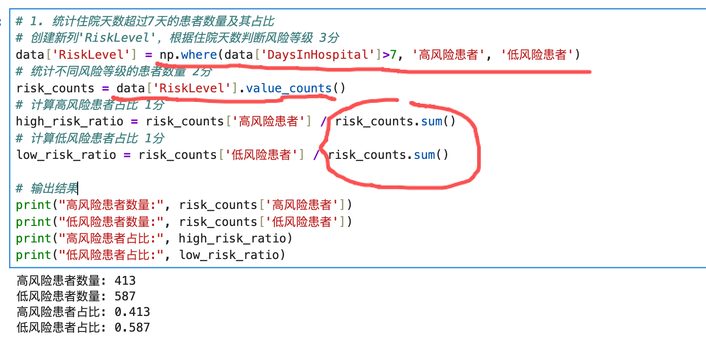

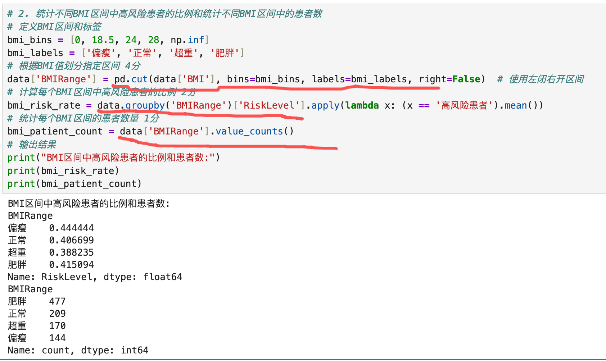

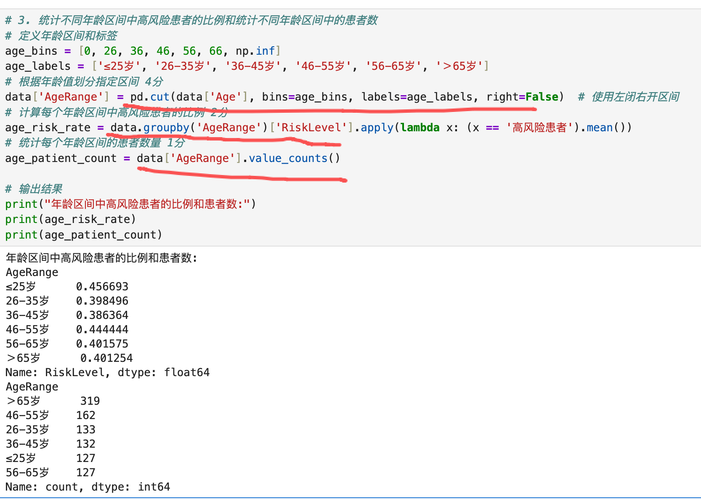


## 题库2.1.3解析

```python
import pandas as pd

# 加载数据
data = pd.read_csv('finance数据集.csv')

# 显示前五行的数据
print(data.head())

import matplotlib.pyplot as plt
import seaborn as sns

# 设置图像尺寸
plt.figure(figsize=(12, 8))

# 识别数值列用于箱线图
numeric_cols = data.select_dtypes(include=['float64', 'int64']).columns

# 创建箱线图
for i, col in enumerate(numeric_cols, 1):
    plt.subplot(3, 4, i)
    sns.boxplot(x=data[col])
    plt.title(col)

plt.tight_layout()
plt.show()

# 使用IQR处理异常值
Q1 = data[numeric_cols].quantile(0.25)
Q3 = data[numeric_cols].quantile(0.75)
IQR = Q3-Q1

# 移除异常值
data_cleaned = data[~((data[numeric_cols] < (Q1 - 1.5 * IQR)) | (data[numeric_cols] > (Q3 + 1.5 * IQR))).any(axis=1)]

# 检查处理重复值
duplicates = data_cleaned.duplicated()
num_duplicates = duplicates.sum()
data_cleaned = data_cleaned[~duplicates]

print(f'删除的重复行数: {num_duplicates}')

#对数据进行归一化处理
from sklearn.preprocessing import MinMaxScaler

scaler = MinMaxScaler()
data_cleaned[numeric_cols] = scaler.fit_transform(data_cleaned[numeric_cols])

# 设定目标变量
target_variable = 'SeriousDlqin2yrs'

from sklearn.model_selection import train_test_split

# 定义特征和目标
X = data_cleaned.drop(columns=[target_variable])   #1分
y = data_cleaned[target_variable]                         #1分

# 划分数据（训练集占80%）
X_train, X_test, y_train, y_test = train_test_split(X,y,train_size=0.8, random_state=42)

# 显示划分后的数据形状
print(f'训练数据形状: {X_train.shape}')
print(f'测试数据形状: {X_test.shape}')

# 保存清洗后的数据到CSV
cleaned_file_path = '2.1.3_cleaned_data.csv'
data_cleaned.to_csv(cleaned_file_path, index=False)

```

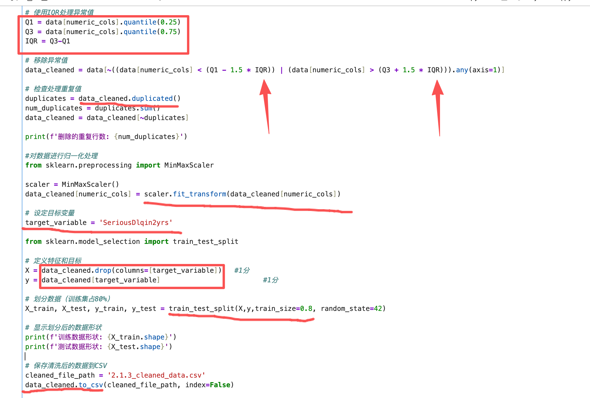

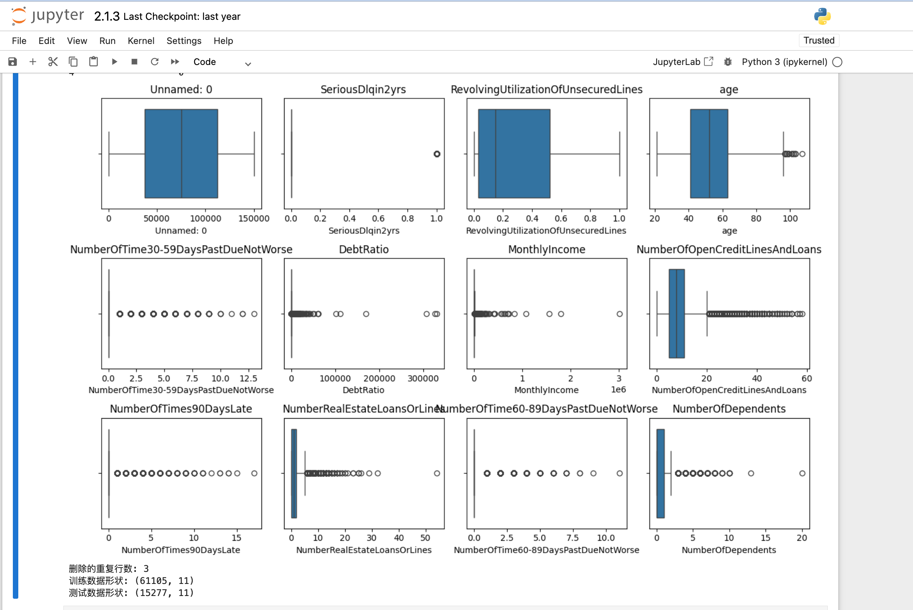

## 题库2.1.4解析

```python
import pandas as pd

# 加载数据集并指定编码为gbk
data = pd.read_csv('medical_data.csv',encoding='gbk')

# 查看数据类型
print(data.dtypes)
# 查看表结构基本信息
print(data.info())

# 显示每一列的空缺值数量
print(data.isnull().sum())

# 规范日期格式
data['就诊日期'] = pd.to_datetime(data['就诊日期'])
data['诊断日期'] = pd.to_datetime(data['诊断日期'])

# 修改列名
data.rename(columns={'病人ID':'患者ID'}, inplace=True)

# 查看修改后的表结构
print(data.head())

from datetime import datetime

# 增加诊断延迟和病程列
data['诊断延迟'] = (data['诊断日期'] - data['就诊日期']).dt.days
data['病程'] = (datetime(2024, 9, 1) - data['诊断日期']).dt.days

# 删除不合理的数据
data = data[(data['诊断延迟'] >= 0) & (data['年龄'] > 0) & (data['年龄'] < 120)]

# 查看修改后的数据
print(data.describe())

# 删除重复值并记录删除的行数
initial_rows = data.shape[0]
data.drop_duplicates(inplace=True)
deleted_rows = initial_rows - data.shape[0]

print(f'删除的重复行数: {deleted_rows}')

from sklearn.preprocessing import MinMaxScaler

# 对需要归一化的列进行处理
scaler = MinMaxScaler()
columns_to_normalize = ['年龄','体重','身高']
data[columns_to_normalize] = scaler.fit_transform(data[columns_to_normalize])

# 查看归一化后的数据
print(data.head())

import matplotlib.pyplot as plt
import matplotlib.font_manager as fm


# 统计治疗结果分布
treatment_outcome_distribution = data.groupby('疾病类型')['治疗结果'].value_counts().unstack()

# 设置中文字体
#font_path = 'C:/Windows/Fonts/simhei.ttf'  # 根据你的系统调整字体路径
font_path = '/System/Library/Fonts/Hiragino Sans GB.ttc'
my_font = fm.FontProperties(fname=font_path)

# 绘制柱状图
treatment_outcome_distribution.plot(kind='bar', stacked=True)
plt.title('不同疾病类型的治疗结果分布', fontproperties=my_font)
plt.xlabel('疾病类型', fontproperties=my_font)
plt.ylabel('治疗结果数量', fontproperties=my_font)
plt.xticks(fontproperties=my_font)  # 设置x轴刻度标签的字体
plt.yticks(fontproperties=my_font)  # 设置y轴刻度标签的字体
plt.legend(prop=my_font)  # 设置图例字体
plt.show()

# 绘制散点图
plt.scatter(data['年龄'], data['疾病严重程度'])
plt.title('年龄和疾病严重程度的关系', fontproperties=my_font)
plt.xlabel('年龄', fontproperties=my_font)
plt.ylabel('疾病严重程度', fontproperties=my_font)
plt.xticks(fontproperties=my_font)  # 设置x轴刻度标签的字体
plt.yticks(fontproperties=my_font)  # 设置y轴刻度标签的字体
plt.legend(prop=my_font)  # 设置图例字体
plt.show()

# 保存处理后得数据
output_path = '2.1.4_cleaned_data.csv'
data.to_csv(output_path, index=False)
```

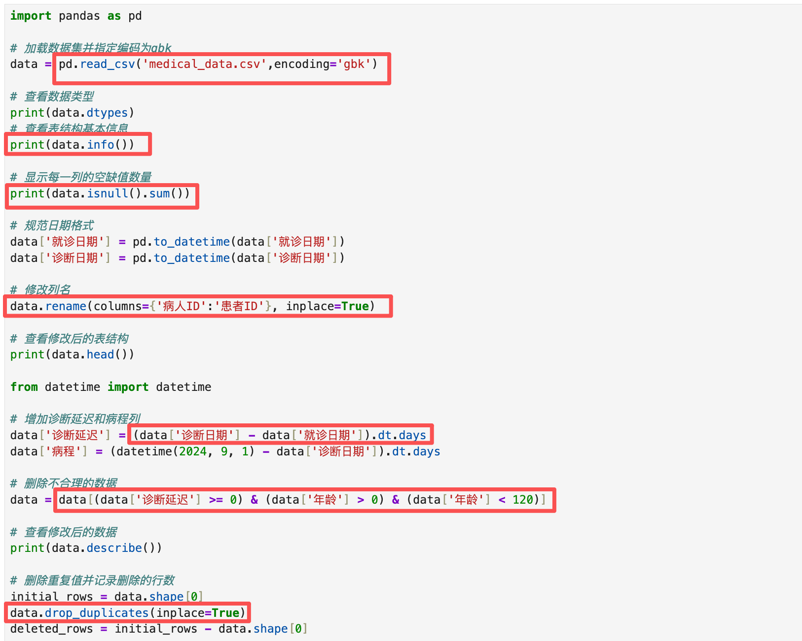

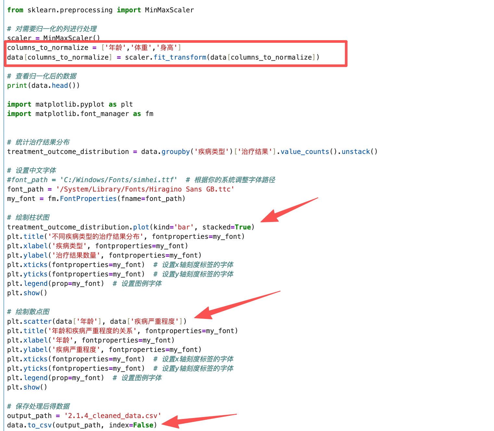

## ==题库2.1.5解析==

```python
import pandas as pd

# 加载数据集
data = pd.read_csv('健康咨询客户数据集.csv')

# 查看表结构基本信息
print(data.info())

# 显示每一列的空缺值数量
print(data.isna().sum())

# 删除含有缺失值的行
data_cleaned = data.dropna()

# 转换 'Your age' 列的数据类型为整数类型，并处理异常值
data_cleaned = data_cleaned.dropna(subset=['Your age'])
data_cleaned['Your age'] = data_cleaned['Your age'].astype(int)
#data_cleaned.loc[:, 'Your age'] = pd.to_numeric(data_cleaned['Your age'].astype(str), errors='coerce')
data_cleaned = data_cleaned.dropna(subset=['Your age'])
data_cleaned = data_cleaned[data_cleaned['Your age'] >= 0]
data_cleaned.loc[:, 'Your age'] = data_cleaned['Your age'].astype(int)

print(data_cleaned['Your age'].dtype)

# 检查和删除重复值
duplicates_removed = data_cleaned.duplicated().sum()
data_cleaned = data.drop_duplicates()

print(f"Removed {duplicates_removed} duplicate rows")

from sklearn.preprocessing import LabelEncoder

# 归一化 'How do you describe your current level of fitness ?' 列
label_encoder = LabelEncoder()
data_cleaned['How do you describe your current level of fitness ?'] = label_encoder.fit_transform('How do you describe your current level of fitness ?')

print(data_cleaned['How do you describe your current level of fitness ?'].unique())

from sklearn.preprocessing import LabelEncoder
import matplotlib.pyplot as plt

# 去掉列名中的空格
data.columns = data.columns.str.strip()
# 显示数据集的列名
print(data.columns)

# 删除包含缺失值的行
data_cleaned = data.dropna(subset=['How often do you exercise?'])

# 统计不同健身频率的分布情况
exercise_frequency_counts = data_cleaned['How often do you exercise?'].value_counts()

# 绘制饼图
plt.figure(figsize=(10, 6))
exercise_frequency_counts.plot.pie(autopct='%1.1f%%', startangle=90, colors=plt.cm.Paired.colors)
plt.title('Distribution of Exercise Frequency')
plt.ylabel('')
plt.show()

import pandas as pd
from sklearn.model_selection import train_test_split
import matplotlib.pyplot as plt

# 填充缺失值
data_filled = data.apply(lambda x: x.fillna(x.mode()[0]))

# 划分数据（测试集占比20%）
train_data, test_data = train_test_split(data_filled,test_size=0.2, random_state=42)

# 保存处理后的数据
cleaned_file_path = '2.1.5_cleaned_data.csv'
data_filled.to_csv(cleaned_file_path, index=False)

```

## 题库2.2.5解析

```python

```

